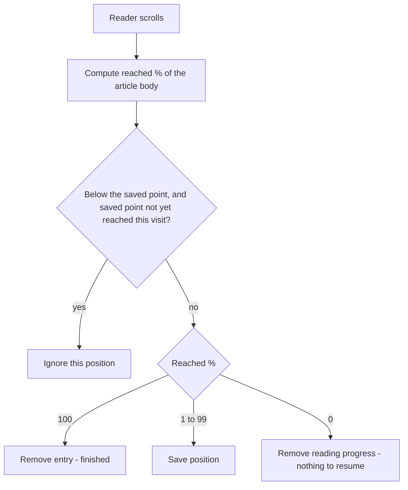

# Reading progress tracker

**Related**

- App handbook (setup and env): [`app/README.md`](../../app/README.md)
- Implementation: [`app/src/composables/useReadingProgressTracker.ts`](../../app/src/composables/useReadingProgressTracker.ts)

The app tracks how far a user has read through the **text body** of a content page and saves that position locally. The homepage **Continue** row shows content still in progress (reading and/or video). Video (or audio) on the same page does not disable tracking when text is present.

Progress is measured **by position**: how far down the article body the bottom of the screen has reached. The saved value follows where the reader **last stopped**, up or down. There are no timers or skim checks — reaching the end of the last paragraph is always 100%.

Visual overview: [`reading-progress-tracker.drawio.svg`](reading-progress-tracker.drawio.svg) (open in [draw.io](https://app.diagrams.net/)). _Note: the diagram still shows the previous segment / gate model and needs redrawing to match this document._

---

## When tracking runs

Tracking is enabled on **SingleContent** when:

- The content has **text** (`content.text`)
- A content id is present

This applies to text-only posts and to posts that also have a video — only the article body is measured, not video playback.

The tracker watches `articleProseRef` — the `<div v-html="text">` that renders the CMS article body.

| Included in progress                                                                       | Not included                                                                                                                   |
| ------------------------------------------------------------------------------------------ | ------------------------------------------------------------------------------------------------------------------------------ |
| The article body (`articleProseRef`), from its first line to the end of its last paragraph | Page title, hero image, summary, author, reading time, publish date, tags, copyright footer, related content below the article |

Progress is **0** until the bottom of the screen reaches the top of the article body, and **100** when the end of the last paragraph is on screen. Related content below the article never counts towards progress.

---

## How progress is calculated

```
reached % = floor((viewportBottom − articleTop) ÷ articleHeight × 100)
reached % = 100 once the article's bottom edge is at or above the viewport bottom
            (READING_BLOCK_END_TOLERANCE_PX = 4 px tolerance)
```

- `viewportBottom` is the bottom of the scroll container — `<main>` when it scrolls (`resolveArticleScrollContainer()`), otherwise the window.
- `articleTop` and `articleHeight` come from the bounding rect of `articleProseRef`.
- Everything is measured from the rendered layout, so font size, zoom, line wrapping and screen size are already reflected.



1. On article open, the saved percentage (if any) is picked up so the reading pill and the session depth start from it. **Nothing is saved yet** — opening an article never writes progress on its own.
2. On each scroll event, `reached %` is computed. Work is coalesced with `requestAnimationFrame`, so it runs at most once per frame.
3. The position is saved to `localStorage` (`contentProgress` key, `reading` field on the content entry):
    - **100%** — the entry's reading progress is **removed**: the article is finished, not "in progress".
    - **1–99%** — the position is saved.
    - **0%** — the reading progress is removed: there is nothing to resume.
4. The saved value **follows where the reader last stopped, up or down**. It is not a high-water mark. Example: the reader reaches 100% (entry removed), scrolls back and stops at 56% → the entry returns to the Continue row at 56%.
5. **Start-of-visit guard.** A position _below_ the saved one is only saved once the reader has reached the saved point during the current visit. This stops stray scroll events when an article opens (page scroll reset after navigation, layout shifts) from overwriting the saved position before the reader has chosen **Continue**. Once the saved point has been reached, every position is saved, including lower ones.
6. A value identical to the last saved one is not rewritten. When saving is disabled (e.g. short articles, `disableSaving`), the live value (`readingProgressPercent`) is still updated but nothing is written to storage.

Tracking is suppressed while a programmatic restore is running (see [Return visit](#return-visit--resume-offer-in-the-reading-pill)) and when the tracker is not enabled.

---

## Segments (kept for consumers)

`collectSegments()` still splits each prose DOM node (`p`, `h1`–`h4`, `li`, `blockquote`, `pre`) into viewport-capped **segments** and fills the `segments` and `sourceElements` refs returned by the composable:

- If the rendered element height fits within the scroll container's `clientHeight`, it is a single segment.
- If the element is taller than the viewport (e.g. a long paragraph on a phone), it is split into equal-height bands — each band is at most one viewport tall.

Segments **do not affect progress**. They are rebuilt on setup and, debounced, on resize or rotation. The prose HTML is **not** modified.

---

## What replaced the gates

Earlier versions confirmed segment by segment through three gates (50% visible, scroll-speed skim detection, per-segment dwell time) and computed `round(confirmed segments ÷ total segments × 100)`. That model is gone from the tracker:

- No **dwell time** — nothing depends on how long a segment stays on screen.
- No **skim detection** — fast scrolling to the end counts as reaching the end.
- No **active segment** and no per-frame loop.
- No **IntersectionObserver**.
- No "progress never decreases" rule — see step 4 above.

The pure helpers that implemented the old gates (`isSegmentEligible`, `resolveActiveSegment`, `applyScrollVelocitySample`, `isScrollAtEnd`, …) and the dwell / words-per-second helpers in `readingTime.ts` are still exported, but the composable no longer calls them. They can be removed together with their tests when convenient. The `averageReadingSpeed` option is still accepted so callers do not break, but it is no longer used.

---

## Storage

**Key:** `localStorage.contentProgress`

**Shape:**

```json
[
    {
        "contentId": "…",
        "updatedAt": 1710000000000,
        "watching": { "mediaId": "…", "progress": 90, "duration": 180 },
        "reading": { "progress": 42 }
    }
]
```

Each entry is keyed by `contentId`. `watching` tracks video/audio playback (seconds); `reading` tracks the reader's last position in the article (0–100%). Both can be present on the same content. Entries are ordered by most recently updated.

**At most 10 entries are kept, and the list rolls.** A new article or video is never blocked: it is added at the front, and when that would make 11 the least recently updated entry is dropped, so the list stays at 10. Opening an older item again moves it back to the front. Finishing an article (100%) removes its reading progress and frees a slot.

On first load, legacy `readingProgress` and `mediaProgress` keys are merged into `contentProgress` and removed.

**API** (`app/src/globalConfig.ts`):

- `setReadingProgress(contentId, progress)` / `getReadingProgress(contentId)` / `removeReadingProgress(contentId)`
- `setMediaProgress(mediaId, contentId, progress, duration)` / `getMediaProgress` / `removeMediaProgress`
- `contentProgressAsRef` — reactive list for the homepage row
- `syncContentProgressFromStorage()` / `watchContentProgressStorage()`

**Homepage:** `ContinueProgress.vue` reads `contentProgressAsRef`, queries published content by id, and renders a horizontal tile row (video and reading in progress together).

---

## Return visit — resume offer in the reading pill

When the user reopens an in-progress article, the top-bar reading pill (`ArticleOutline.vue`) opens as a **Continue where you left off** offer with the saved percentage on its track. The user chooses:

- **Continue where you left off** — scrolls to the saved position (see below)
- **Start from top** (×) — dismisses the offer; saved progress is kept
- Scrolling into the article also dismisses it

Either way the pill becomes the chapter dropdown, which keeps a _Continue where you left off_ entry while a saved position exists. The resume offer's track shows `readingProgressPercent` (the reader's current position in the article, kept even when saving is disabled for short articles); the chapter dropdown's track follows `scrollProgressPercent`, the viewport's position within the article.

**Where Continue scrolls to.** The saved percentage is a point inside the **article body**, not a share of the whole scroll container (which also holds the title, hero and related content). Restore is the inverse of the progress formula: it scrolls so that point of the article sits at the **bottom of the screen**, with the same 300 ms delay that lets layout settle. The reader lands on the last screen they were on, and the text they have not read yet is just below it. A finished article (100%) has no saved position, so no resume is offered and Continue never jumps into the related content below the article.

During programmatic restore, for **400 ms** (`READING_RESTORE_GUARD_MS`), tracking is suppressed so the scroll jump does not count as reading.

---

## Future: time-on-article analytics

Recording how long a user spends on an article (idle pause, total read time) is deferred to a follow-up ticket. The position-based tracker does not measure time, so a time metric would be added separately. The composable's `onSessionEnd` callback already reports the **furthest point reached** (0–100) when a session ends, read from live in-memory state rather than the store (which deletes the reading entry at 100%).

---

## Performance

The tracker runs on every article view and must stay smooth on **low-end Android
devices** — that is the budget every change here is held to. The rules that keep it
inside that budget:

- **One layout read per scroll frame.** Scroll events only schedule a single
  `requestAnimationFrame`; each frame reads the bounding rect of the article body (plus the
  progress root for the chapter pill's track) and does arithmetic. Nothing iterates the
  article's blocks while scrolling.
- **Per-block layout and text reads happen only in `collectSegments()`** — on setup and on
  debounced resize — never per scroll event or per frame.
- **Nothing runs while the reader is not scrolling.** There is no per-frame loop, timer or
  IntersectionObserver.
- **Saves are de-duplicated.** Storage is only written when the whole-number percentage
  changes (`lastSavedProgress`).
- **Resize re-collection is debounced** (`READING_RESIZE_DEBOUNCE_MS`) because Android's
  URL bar collapse fires viewport resizes during ordinary scrolling.

When changing this code, keep per-block DOM reads (rects, `textContent`,
`querySelectorAll`) inside `collectSegments()`, and keep the per-scroll path down to the
single article-body measurement.

---

## Source files

| File                                               | Role                                                                                               |
| -------------------------------------------------- | -------------------------------------------------------------------------------------------------- |
| `app/src/pages/SingleContent/SingleContent.vue`    | Wires the tracker and the reading pill                                                             |
| `app/src/composables/useReadingProgressTracker.ts` | Position tracking, saving, scroll restore (also exports the legacy segment / gate helpers)         |
| `app/src/util/readingTime.ts`                      | Estimated reading time and WPM helpers; dwell and words/sec helpers kept but unused by the tracker |
| `app/src/contentProgress.ts`                       | `localStorage` read/write (`contentProgress`), 10-entry rolling list                               |
| `app/src/components/HomePage/ContinueProgress.vue` | Homepage row                                                                                       |
| `app/src/pages/SingleContent/ArticleOutline.vue`   | Reading pill: resume offer, chapter dropdown, progress track                                       |

---

## Constants

Used by the tracker:

| Constant                         | Value | Meaning                                                                                        |
| -------------------------------- | ----- | ---------------------------------------------------------------------------------------------- |
| `READING_BLOCK_END_TOLERANCE_PX` | `4`   | Subpixel tolerance when deciding the article's end has reached the bottom of the screen (100%) |
| `READING_RESTORE_GUARD_MS`       | `400` | Ignore tracking after programmatic restore                                                     |
| `READING_RESIZE_DEBOUNCE_MS`     | `200` | Debounce for resize-driven re-collection of segments                                           |

Still exported but no longer used by the tracker (belong to the removed gate model):

| Constant                          | Value  | Meaning                                                                     |
| --------------------------------- | ------ | --------------------------------------------------------------------------- |
| `READING_INTERSECTION_RATIO`      | `0.5`  | Segment must be half visible                                                |
| `READING_SCROLL_END_TOLERANCE_PX` | `2`    | Tolerance for `isScrollAtEnd`                                               |
| `READING_SKIM_WPM_MULTIPLIER`     | `3`    | Skim cap = 3× language reading rate (w/s)                                   |
| `READING_MIN_SCROLL_SAMPLE_MS`    | `50`   | Batch scroll events before words/s check                                    |
| `READING_MIN_DWELL_MS`            | `500`  | Minimum dwell per segment                                                   |
| `READING_MAX_DWELL_MS`            | `8000` | Maximum dwell per segment                                                   |
| `DEFAULT_READING_SPEED_WPM`       | `200`  | Fallback when language has no WPM (still used by the reading-time estimate) |

---

## Tests

- `app/src/composables/useReadingProgressTracker.spec.ts` — position-based progress (reached %, 100% at the end of the last paragraph), saving up and down, the start-of-visit guard, restore to the saved point, plus the exported segment / gate helpers
- `app/src/util/readingTime.spec.ts` — reading-time estimate, dwell and words/sec math
- `app/src/pages/SingleContent/__tests__/ArticleOutline.spec.ts` — reading pill UI

```sh
cd app && npm run test -- src/util/readingTime.spec.ts src/composables/useReadingProgressTracker.spec.ts src/pages/SingleContent/__tests__/ArticleOutline.spec.ts
```
