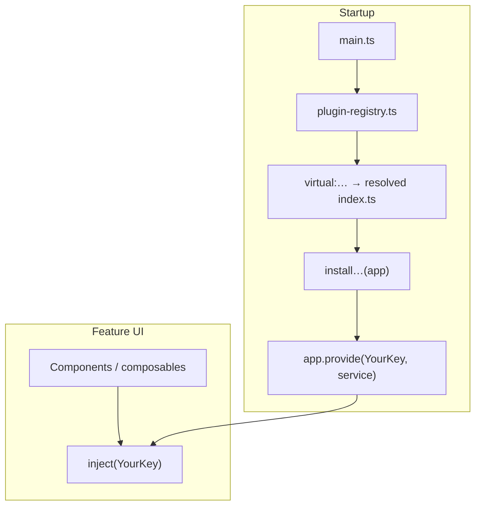

# Build-time plugin architecture (Luminary web app)

This document describes a **contract-driven** way to plug in behavior in the Vue app (`luminar/app`): **one TypeScript interface per concern**, **one implementation chosen when the bundle is built**, **`provide` / `inject`** for consumers, and **no feature code importing concrete adapter paths**.

**Related**

- **Presentation-style explainer** (build vs runtime, checklist, Q&A): [`plugin-system-explained.md`](./plugin-system-explained.md)
- App handbook (setup and env): [`app/README.md`](../../README.md)
- Concrete file walkthrough using the repo's first plugin: [`starter-code.md`](./starter-code.md)
- Diagram sources (open in [diagrams.net](https://app.diagrams.net/) / draw.io; export SVG if needed):
  - **[`plugin-system-folders.drawio`](./plugin-system-folders.drawio)** — **folder tree** (`build-time/contracts/`, `build-time/plugins/`, `vite-plugins/`) with file-level annotations.
  - **[`vue-plugin-architecture.drawio`](./vue-plugin-architecture.drawio)** — components and swimlanes (build, bootstrap, provide/inject, checklist for a second plugin).
  - **[`vue-plugin-architecture-flow.drawio`](./vue-plugin-architecture-flow.drawio)** — **end-to-end flow** top to bottom: resolve → bundle → bootstrap → `provide` → `inject` (and how to repeat for another plugin).
  - The companion **`.svg`** files in this folder are exports for quick viewing; if labels drift, re-export from the `.drawio` sources.

---

## What we are optimizing for

- **Stable surface for UI** — Pages and components depend on an interface and an injection key, not on concrete implementation paths.
- **Small bundles** — Only the resolved implementation is bundled; unresolved code is not part of the graph.
- **Clear boundaries** — Contracts and tokens live in `build-time/contracts/<name>/`; implementations in `build-time/plugins/<name>/`; a single **registry** (`plugin-registry.ts`) composes what gets registered on the app.

## Core pieces (generic)

| Piece | Role |
| --- | --- |
| **Contract** | TypeScript types + service interface (`contract.ts`) in `build-time/contracts/<name>/`. |
| **Token** | `InjectionKey<YourService>` in `token.ts` (same folder as contract). Does **not** import the virtual module so UI can import the key without pulling in the adapter graph. |
| **Implementation** | Class(es) in `build-time/plugins/<name>/` (e.g. `<name>-web.ts`) that satisfy the contract. |
| **Virtual entry** | `build-time/plugins/<name>/index.ts`: `install…(app)`, `app.provide(YourKey, instance)`, re-exports. This is what Vite resolves. |
| **Vite** | A plugin maps `virtual:<name>` → `build-time/plugins/<plugin>/index.ts` via `resolveId`. |
| **Registry** | `src/build-time/contracts/plugin-registry.ts` imports `virtual:…` modules and exposes `installPlugins(app)`, which `main.ts` calls and awaits, so bootstrap stays one place. `appPluginsManager` wraps it for `app.use` where nothing waits. |

### What `virtual:…` means

A **virtual module** is an **import id that does not point to a real file by itself** (for example `virtual:media-player`). At build time, the Vite plugin `app/vite-plugins/buildTargetVirtuals.ts` implements **`resolveId`**: when the bundler sees that id, it returns an **absolute path** to the actual entry file (`build-time/plugins/<name>/index.ts`). Application code always imports the **same** virtual id regardless of which implementation is wired up. See [Vite — Virtual Modules Convention](https://vite.dev/guide/api-plugin.html#virtual-modules-convention).

---

## Build time vs runtime

### Build time

Vite resolves each `virtual:<name>` import to the corresponding `build-time/plugins/<name>/index.ts`. Only that file tree is included in the bundle.

### Runtime



**Typical steps**

1. **`main.ts`** calls **`installPlugins(app)`** from `@/build-time/contracts/plugin-registry` and awaits what it returns before mounting (see [Optional plugins](#optional-plugins)).
2. The registry imports **`virtual:…`** (not `build-time/plugins/...` directly).
3. The resolved module runs **`install…(app)`**, which constructs the service and **`provide`s** it on the app.
4. Feature code **`inject(YourKey)`** and calls only the contract. Import **`YourKey`** from **`token.ts`**, not from the registry, so components do not depend on the virtual module's dependency graph.

---

## Repository shape (conceptual)

```text
app/
  vite-plugins/
    buildTargetVirtuals.ts             # maps virtual:… → build-time/plugins/<name>/index.ts
  src/
    build-time/contracts/
      plugin-registry.ts               # imports virtual modules; installPlugins
      <plugin-name>/
        contract.ts
        token.ts
    build-time/plugins/
      <plugin-name>/
        index.ts                       # virtual module entry: install + provide
        <plugin-name>-web.ts           # implementation
```

See the [folder diagram (`plugin-system-folders.drawio`)](./plugin-system-folders.drawio) for the full visual tree.

---

## Adding another plugin

Each new capability gets its **own** `virtual:<name>` id and **parallel** entries in both `src/build-time/contracts/` and `src/build-time/plugins/`. The media player is not special — the same steps apply to plugin #2, #3, and so on. The diagram at [`vue-plugin-architecture.drawio`](./vue-plugin-architecture.drawio) includes a **checklist swimlane** for this.

1. **Scaffold contracts** — create **`app/src/build-time/contracts/<name>/`**:
   - **`contract.ts`** — interface + types for the service.
   - **`token.ts`** — `InjectionKey<…>` only (no import from `virtual:…`).

2. **Scaffold implementation** — create **`app/src/build-time/plugins/<name>/`**:
   - **`<name>-web.ts`** — class that satisfies the contract.
   - **`index.ts`** — `install<Name>(app)` that **`provide`**s the implementation under the key from `token.ts`, plus any re-exports the registry needs.

3. **Teach Vite the new id** — in **`app/vite-plugins/buildTargetVirtuals.ts`**, add the id to **`virtualTargets`**, and its name to **`platformSwappable`** when a packaged-app target must supply it, or to **`optionalSwappable`** when it may (see [Optional plugins](#optional-plugins)):

```ts
"virtual:my-feature": `${root}/build-time/plugins/my-feature/index.ts`,
```

4. **Type the virtual module** — in **`app/env.d.ts`**, add **`declare module "virtual:my-feature"`** (or whatever id you chose) exporting **`install…`** and the injection key type, mirroring **`virtual:video-player`**.

5. **Wire bootstrap** — in **`app/src/build-time/contracts/plugin-registry.ts`**, **`import`** from **`virtual:my-feature`**, call **`installMyFeature(app)`** inside **`installPlugins`**, and re-export keys/types as needed.

6. **Use it in UI** — **`inject`** using the key imported from **`@/build-time/contracts/<name>/token`**, not from the virtual module.

**Order of `install*` calls** usually does not matter unless one plugin's `install` depends on another's `provide` being ready; keep dependencies explicit in **`installPlugins`**.

---

## Optional plugins

Most build-swapped services are **required**: every target supplies one, and a packaged-app build whose implementation directory (`VITE_NATIVE_IMPL_DIR`) lacks `<name>.ts` fails to build. Some capabilities only exist on some targets. These are **optional**, listed in the `optionalSwappable` set in `vite-plugins/buildTargetVirtuals.ts`:

| | File in the implementation directory | Resolves to |
| --- | --- | --- |
| Required (`platformSwappable`) | present | `<impl dir>/<name>.ts` |
| Required | missing | `<impl dir>/<name>.ts`, so the build fails |
| Optional (`optionalSwappable`) | present | `<impl dir>/<name>.ts` |
| Optional | missing | the in-app entry, `build-time/plugins/<name>/index.ts` |

The web builds have an implementation directory of their own, `VITE_WEB_IMPL_DIR`, which only optional names resolve from: a required name keeps its in-app entry there, and with the variable unset nothing changes. A packaged-app build (`VITE_NATIVE_IMPL_DIR` set) ignores it. Bare package imports in a file from either directory resolve against the app's own dependencies.

An optional plugin follows the same contract, token and registry pattern, with these differences:

1. **The in-app entry provides nothing** (or, where consumers need something to hold on to, an empty holder). The web builds and any target that leaves the file out carry none of the feature.
2. **Consumers treat the service as possibly absent:** `inject(YourKey, undefined)`, and render nothing when it is `undefined`. Components the feature shows are handed out by the service itself (for example `service.ui.SomeBadge`), the way `VideoPlayerService.component` is, so a consumer never imports them.
3. **The feature's code is reached through one module.** A target's own entry hands its platform engine to a single `provide…(app, engine)` function, which builds the service and provides it. Everything else of the feature lives in its own folder that only that function imports, and ESLint rules in `.eslintrc.cjs` keep it that way: `no-restricted-imports` for static imports and re-exports, `no-restricted-syntax` for `import()`, and a stricter override for the in-app entry, which may import nothing of the feature outside a development-only branch. Because only a target's own entry imports the `provide…` function, a build without that entry cannot contain the feature.
4. **Its `install…(app)` may return a promise** (`void | Promise<void>` in `env.d.ts`) when the answer comes asynchronously, for example from a platform plugin. It must never reject.

**Consumers inject once at setup.** A component set up before an optional service is provided never sees it. Two ways around that:

- **Hold the mount.** `installPlugins` returns a promise that settles once downloads are provided or known absent, and `main.ts` awaits it beside its other pre-mount work, capped at 1.5 s so a target whose plugin never answers still mounts. Components set up after a late answer still get the service.
- **Provide a holder.** Provide a reactive holder at app creation and fill it later; consumers read through it, so anything already rendered updates when the service lands. App promotion does this.

**Example: downloads.** `virtual:downloads` resolves to the target's `downloads.ts` when it exists, else to `build-time/plugins/downloads/index.ts`. A target with a downloads engine calls `provideDownloads(app, engine)` from `build-time/plugins/downloads/provide.ts`, the only importer of `src/downloads/**`; it builds the `DownloadsService`, adds the `/downloads` route with `router.addRoute`, and provides the service under `DownloadsKey`. The in-app entry provides nothing, except on the development server with `?fakeDownloads`: there it loads `provideFakeDownloads` from `provide.ts` through an `import()` inside an `if (import.meta.env.DEV && …)` branch, which provides the service over an in-memory engine so the downloads UI can be built in a browser. A build replaces `import.meta.env.DEV` with `false` and drops that branch with its import, so neither web bundle contains any of it; the in-app entry's ESLint override allows no other `import()`, and accepts this one only in the consequent of an `if` whose test is `import.meta.env.DEV && …` (not in an `else` branch, the test itself, or under `DEV || …`, none of which a build drops). The entry returns that import's promise, so the mount waits for the fake like any other answer; a first navigation to `/downloads` that went ahead without the route is sent there again.

**Example: app promotion.** `virtual:app-promo` lets a build place promotional content on the page. Its contract (`build-time/contracts/app-promo/`) is an `AppPromoService` that answers `component(placement)` for a named placement, `AppPromoPlacement`:

| Placement | Where |
| --- | --- |
| `player-download` | the page's own now-playing screen, in its tools, where the platform's screen has its download tool |

A placement is drawn with `<AppPromoSlot placement="…" />` from `build-time/plugins/app-promo/`, which renders the service's component for it and nothing at all (no element, no wrapper) without one. `provideAppPromoHolder(app)` in `build-time/plugins/app-promo/provide.ts` provides an empty holder under `AppPromoKey`, and a target's own `app-promo.ts` hands its service to `provideAppPromo(app, service)`, which fills that holder. The in-app entry's `installAppPromo` only provides the holder, so with no implementation every placement stays empty.

- **SPA** (`main.ts`): `installPlugins` provides the holder, then calls `installAppPromo`. The mount does not wait for it.
- **SSG site** (`main.web.ts`): the setup provides the holder on both sides of the prerender, so prerendered HTML and the first client render carry only the empty placement. On the client, `installSsgAppPromo` in `src/ssg/clientRuntime.ts` loads `virtual:app-promo` and calls `installAppPromo` once the page has hydrated, so the module is off the path to the data layer, auth and the mount. The prerender never loads or installs it, so prerendered HTML is the same with or without an implementation.

A web build supplies an implementation by setting `VITE_WEB_IMPL_DIR` to a directory with `app-promo.ts`; a packaged-app build puts it in `VITE_NATIVE_IMPL_DIR`.

---

## Testing

**`provide`** a mock implementation of the **contract** under the same **`InjectionKey`**. Mock the interface, not any concrete file under `build-time/plugins/`.

---

## Example: global media player

The media player is the reference implementation of this pattern in the repo.

| Concept | In this repo |
| --- | --- |
| Virtual module | `virtual:media-player` |
| Contract | `MediaPlayerService` in `app/src/build-time/contracts/media-player/contract.ts` |
| Token | `MediaPlayerKey` in `app/src/build-time/contracts/media-player/token.ts` |
| Registry | `app/src/build-time/contracts/plugin-registry.ts` |
| Implementation | `WebMediaPlayerService` in `build-time/plugins/media-player/media-player-web.ts`; entry `build-time/plugins/media-player/index.ts`; DOM `<audio>` in `WebMediaAudioElement.vue` |
| Consumers | e.g. `App.vue`, `AudioPlayer.vue` — **`inject(MediaPlayerKey)`**, key imported from **`token.ts`** |

Vite resolves **`virtual:media-player`** to **`app/src/build-time/plugins/media-player/index.ts`**. More detail and snippets: [`starter-code.md`](./starter-code.md).

---

## References

- [Vue — Plugins](https://vuejs.org/guide/reusability/plugins.html)
- [Vue — Provide / inject](https://vuejs.org/guide/components/provide-inject)
